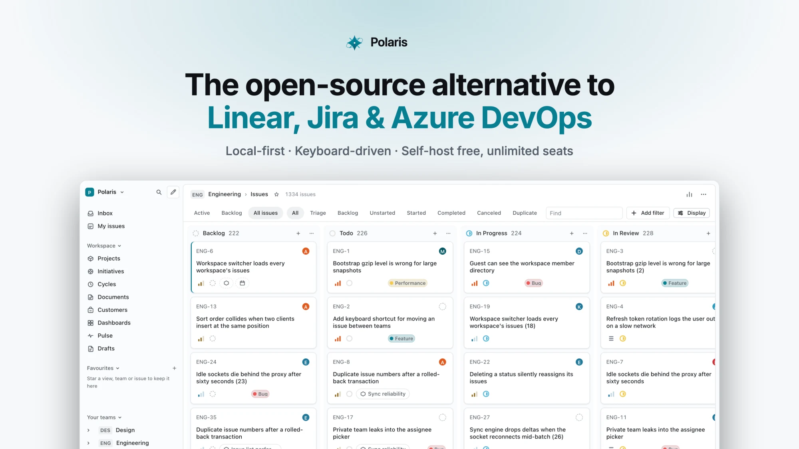
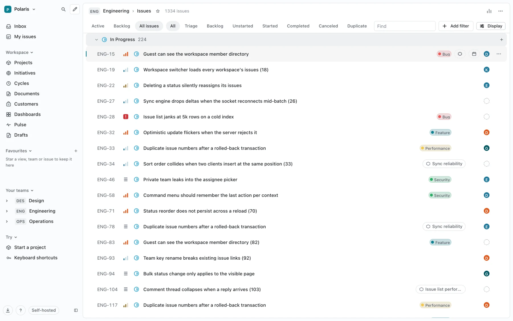
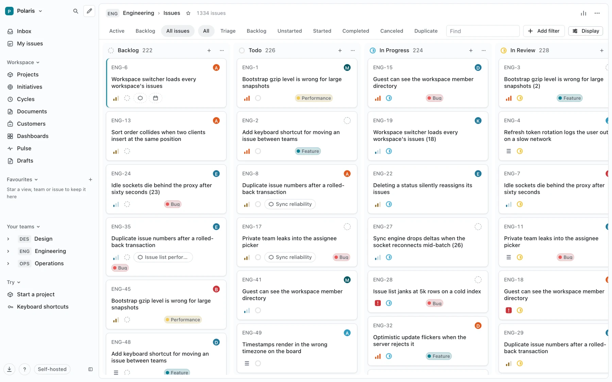
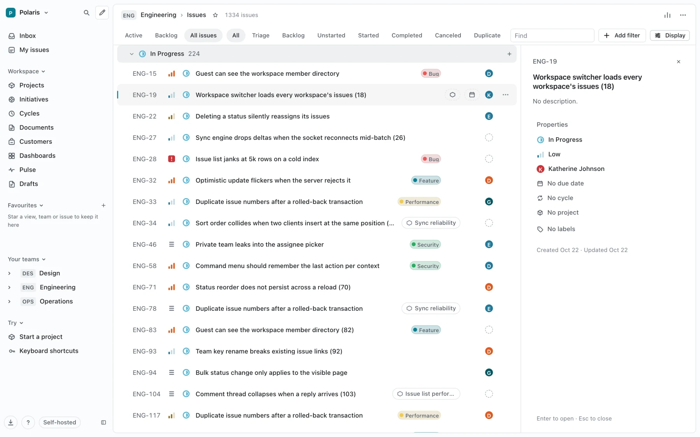
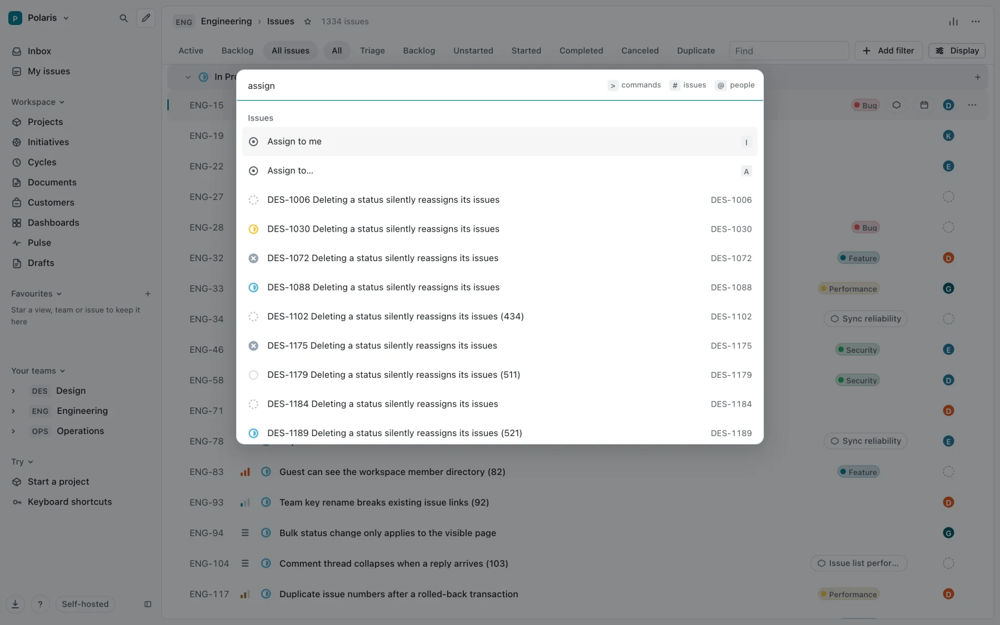

<div align="center">

<a href="https://polaris.peixotolabs.com">
  <picture>
    <source media="(prefers-color-scheme: dark)" srcset=".github/assets/hero-dark.webp">
    
  </picture>
</a>

<h3>The open-source alternative to Linear, Jira and Azure DevOps Boards.</h3>

Keyboard-first, local-first issue tracking for software teams.<br>
Your whole workspace lives on your machine, so filtering, sorting and grouping<br>take a keystroke — not a round trip. Self-host it free with unlimited seats, or use our EU cloud.

<p>
  <a href="https://polaris.peixotolabs.com"><b>Website</b></a> ·
  <a href="https://polaris.peixotolabs.com/signup"><b>Try the cloud</b></a> ·
  <a href="docs/05-infrastructure/11-self-hosting.md"><b>Self-host</b></a> ·
  <a href="docs/"><b>Docs</b></a> ·
  <a href="https://polaris.peixotolabs.com/pricing"><b>Pricing</b></a> ·
  <a href="https://github.com/mcpeixoto/polaris/discussions"><b>Discussions</b></a>
</p>

[](https://github.com/mcpeixoto/polaris/stargazers) [](https://github.com/mcpeixoto/polaris/releases/latest) [](https://github.com/mcpeixoto/polaris/releases) [](https://github.com/mcpeixoto/polaris/actions/workflows/ci.yml) [](LICENSE) [](services/go.mod) [](docs/05-infrastructure/11-self-hosting.md)

**Download** — [macOS Apple Silicon](https://github.com/mcpeixoto/polaris/releases/latest/download/Polaris-mac-arm64.dmg) · [macOS Intel](https://github.com/mcpeixoto/polaris/releases/latest/download/Polaris-mac-x64.dmg) · [Windows](https://github.com/mcpeixoto/polaris/releases/latest/download/Polaris-Setup.exe) · [Linux AppImage](https://github.com/mcpeixoto/polaris/releases/latest/download/Polaris-linux-x86_64.AppImage) · [.deb](https://github.com/mcpeixoto/polaris/releases/latest/download/polaris-amd64.deb)

<sub>The mac and Windows builds are not signed yet, so the first launch needs right-click → Open on macOS, or More info → Run anyway on Windows.</sub>

</div>

---

## Why Polaris

- **Fast because it is local.** Polaris keeps a full replica of your workspace in the browser
  and answers from it — the server's job is to keep that replica true, not to be asked
  permission for a sort.
- **Yours to run.** One Compose file, free under the AGPL, with no ceiling on seats, teams or history.
- **Open, not a demo.** The core is AGPL-3.0. The public GraphQL API is the same API the
  product itself uses — there is no private backdoor.
- **Built for agents too.** An MCP server, an in-app agent, OAuth apps, personal API keys and
  signed webhooks come in the box.

Measured against a 50 ms budget, not asserted:

| | |
|---|---|
| Filter, group and sort 5,000 issues with four active clauses | **0.2 ms** |
| Full workspace snapshot | **24 ms**, 20 KB gzipped |
| Local commit to the rest of the team seeing it | **< 100 ms** |

## How it compares

| | Polaris | Linear | Jira | Azure DevOps Boards |
|---|:---:|:---:|:---:|:---:|
| Open source | ✅ AGPL-3.0 | ❌ | ❌ | ❌ |
| Self-host for free, any team size | ✅ unlimited seats | ❌ cloud only | ❌ Data Center is paid | ❌ free Express tier is for 5 users or fewer |
| Local-first — reads from an on-device replica | ✅ | ✅ | ❌ | ❌ |

<sub>Accurate to the best of our knowledge on 2026-11-27 — if something has changed, a PR with
a source is welcome. Linear, Jira and Azure DevOps are trademarks of their respective owners;
see [`TRADEMARK.md`](TRADEMARK.md).</sub>

<table>
  <tr>
    <td width="50%"><picture><source media="(prefers-color-scheme: dark)" srcset=".github/assets/screenshots/issues-dark.webp"></picture><p align="center"><sub><b>Issue list</b> — grouped, filtered and sorted locally</sub></p></td>
    <td width="50%"><picture><source media="(prefers-color-scheme: dark)" srcset=".github/assets/screenshots/board-dark.webp"></picture><p align="center"><sub><b>Board</b> — the same view, one keystroke away</sub></p></td>
  </tr>
  <tr>
    <td width="50%"><picture><source media="(prefers-color-scheme: dark)" srcset=".github/assets/screenshots/peek-dark.webp"></picture><p align="center"><sub><b>Peek</b> — <code>Space</code> opens an issue without leaving the list</sub></p></td>
    <td width="50%"><picture><source media="(prefers-color-scheme: dark)" srcset=".github/assets/screenshots/command-dark.webp"></picture><p align="center"><sub><b>Command menu</b> — <code>⌘K</code> for every action</sub></p></td>
  </tr>
</table>

## Try it

```bash
make up && make migrate && make seed
make dev
```

That brings up Postgres, applies 77 migrations, seeds a realistic workspace, and runs the
API on `:8088`, the sync hub on `:8089`, the worker, and Vite on `:5173`. Open
http://localhost:5173/ and it opens as the seed account — no login form.

Run them separately with `make api`, `make sync`, `make worker`, `make web`. The worker is
what turns changes into inbox notifications; skip it and the inbox stays empty.

Or skip the setup: [**polaris.peixotolabs.com**](https://polaris.peixotolabs.com/signup) is the
hosted version, EU-only.

## Self-host it

One Compose file, no published ports on any datastore, a reverse proxy terminating TLS in
front. Free, under the AGPL, with **no ceiling on seats, teams or history** — that is what
makes it open source rather than a demo.

```bash
cp .env.example .env      # set POSTGRES_PASSWORD, POLARIS_JWT_SECRET, POLARIS_PUBLIC_URL
docker compose up -d
```

[**docs/05-infrastructure/11-self-hosting.md**](docs/05-infrastructure/11-self-hosting.md)
is the runbook, and it is written to be followed on a machine that is not ours: every
environment variable, what breaks when it is wrong, and the failure modes that look like
something else.

Registration is **invite-only by default** on a self-hosted install — the first account
bootstraps it, everybody after that needs an invitation. [Our cloud](https://polaris.peixotolabs.com)
runs open signup and is EU-only.

## What it does

**Issues** — parent/sub-issues, relations, estimates, due dates, priorities, labels,
templates, recurring issues. Triage as a hidden intake status: accept, duplicate, decline,
snooze. Auto-close and auto-archive that respect parents, subs and projects.

**Projects and initiatives** — cross-team projects with milestones, health from the latest
update, dependency lines, a Gantt timeline, project labels, attached saved views, project
templates. Initiatives group projects, nest up to five deep, and roll health up.

**Cycles** — per-team cadence, auto-created windows, rollover and auto-add, capacity graph.

**Teams** — sub-teams with inherited privacy, private teams, guests, retire/restore, a
30-day delete window.

**Documents, comments, notifications** — team and project markdown docs, threaded comments
and reactions, an inbox with subscriptions, coalescing fan-out and digest email.

**Platform** — one GraphQL API over the whole domain, webhooks with HMAC-SHA256 and an SSRF
pin, OAuth apps and scopes, personal API keys, an MCP server, and an in-app agent. The
public API is the same API the product itself uses; there is no private backdoor.

**Clients** — web, an Electron desktop shell for macOS, Windows and Linux with auto-update
and deep links, and a native iOS app.

Everything is driven from one keymap registry — the command menu and the help overlay are
views over it, not separate lists. `Space` peeks, `⌘K` commands, `G` then a letter goes
somewhere.

## How it is built

- **Go 1.26** backend — `gqlgen` GraphQL, a WebSocket sync hub, a worker. 30 packages, 193 test files.
- **TypeScript/React** frontend — IndexedDB replica, in-memory indexes, a durable outbox, optimistic mutations. 324 test files.
- **Custom delta sync** — gapless per-workspace versions, NDJSON bootstrap, resume, revoke, backpressure. Client schema version 54.
- **Postgres 17** — 77 migrations, UUIDv7, a monthly-partitioned change log.
- **Docker Compose** for the whole stack, with `Caddyfile` as the reference edge.

Six discipline lints run in CI and are gates, not suggestions: every colour is a
`var(--token)`, every shortcut goes through the keymap registry, every route a server
registers is routed by the proxy, package imports respect their boundaries, Compose
profiles stay honest, and the community build is proven — from the linked packages of the
built binary, not from a build tag — to contain nothing from `ee/`.

## The repository

| Path | What's in it |
|---|---|
| [`services/`](services/) | Go: GraphQL API, sync hub, worker, admin CLI |
| [`web/`](web/) | TypeScript: local-first store, sync client, keymap, UI |
| [`desktop/`](desktop/) | Electron shell — the same bundle as the web app |
| [`ios/`](ios/) | Native iOS app and its shared `PolarisCore` package |
| [`ee/`](ee/) | Enterprise features, under a separate commercial licence |
| [`schema/`](schema/) | The GraphQL contract, in one file |
| [`docs/00-overview/`](docs/00-overview/) | Product shape, domain model (ERD), glossary |
| [`docs/01-features/`](docs/01-features/) | One file per feature area — behaviour, config, edge cases |
| [`docs/02-integrations/`](docs/02-integrations/) | Integration catalogue and per-integration contracts |
| [`docs/03-platform/`](docs/03-platform/) | GraphQL API, webhooks, OAuth, agents, rate limits |
| [`docs/04-scope/`](docs/04-scope/) | Inventory, dependency graph, build phases, non-goals |
| [`docs/05-infrastructure/`](docs/05-infrastructure/) | Stack, sync engine, data layer, deployment, security, self-hosting |
| [`docs/06-product-model/`](docs/06-product-model/) | Licensing, packaging, running the project |
| [`docs/07-milestones/`](docs/07-milestones/) | Scope freezes and the acceptance tests that define done |

**New here?** `00-overview/01-product-summary.md` → `00-overview/02-domain-model.md` →
`04-scope/03-dependency-graph.md` → `05-infrastructure/01-architecture-overview.md`.

## Where the requirements came from

The functional scope in `docs/01-features/` came from research into what an issue tracker
for software teams has to do. That research drew on public product documentation — among it
[Linear](https://linear.app)'s product and platform docs, read in full on **2026-08-14**.

That provenance is stated rather than hidden, because it is what makes those documents
trustworthy: where a behaviour is recorded there, it is a behaviour somebody documented, and
where the docs were silent and a decision was needed it is marked **[INFERRED]** or
**[OPEN]**. Knowing which is which is the whole value of the exercise.

The prose, code and assets in this repository are original. No Linear source code, assets,
icons, copy or documentation text were used, and nothing was reverse-engineered from a
running product. Polaris makes its own decisions — see `docs/05-infrastructure/`, starting
with the sync engine and the permission model. See [`NOTICE`](NOTICE) and
[`TRADEMARK.md`](TRADEMARK.md).

## Licence

The core is [**AGPL-3.0**](LICENSE). Enterprise features live in [`ee/`](ee/) under a
separate commercial licence — source-available, not open source, and never linked into the
community build.

Self-hosting is free and unlimited on seats. The paid pitch is "you would rather not keep a
Postgres alive", plus SSO, SCIM, audit log and dashboards for the organisations that need
them. See [`docs/06-product-model/02-plans-and-packaging.md`](docs/06-product-model/02-plans-and-packaging.md).

## Contributing

[`CONTRIBUTING.md`](CONTRIBUTING.md) has the shape of it, and
[`CODE_OF_CONDUCT.md`](CODE_OF_CONDUCT.md) the rest. Security reports go to
[`SECURITY.md`](SECURITY.md) — please do not open a public issue for one.
Questions and ideas go to [Discussions](https://github.com/mcpeixoto/polaris/discussions).

Before you push: `make check`.

<a href="https://github.com/mcpeixoto/polaris/graphs/contributors">
  
</a>

## Star history

If Polaris is useful to you, a ⭐ helps other teams find it — and **Watch → Custom → Releases**
gets you every release the moment it ships.

<a href="https://star-history.com/#mcpeixoto/polaris&Date">
  <picture>
    <source media="(prefers-color-scheme: dark)" srcset="https://api.star-history.com/svg?repos=mcpeixoto/polaris&type=Date&theme=dark">
    
  </picture>
</a>
